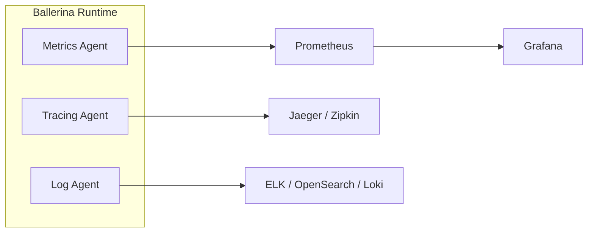

Observability is how you understand an integration's runtime behavior, using metrics, logs, and traces. WSO2 Integrator emits all three, and you choose where they go.

Two distinct activities sit under this heading, and it is worth keeping them apart:

- **Monitoring** answers *"is it behaving as expected?"* It watches known indicators and alerts when they fall outside expected ranges. Useful for problems you anticipated.
- **Diagnosis** answers *"why is it behaving this way?"* It uses logs, metrics, and traces to explain what is actually happening. Useful for problems you did not anticipate.

:::info[Observability follows your deployment]
Like [managing](../manage/index.mdx) integrations, how you observe them depends on where they run:

- **Deployed to WSO2 Cloud:** observability is built in, with nothing to set up. See [Observe on WSO2 Cloud](https://wso2.com/integration-platform/docs/saas/observe).
- **Running on your own infrastructure:** the [Integration Control Plane](https://wso2.com/integration-platform/docs/integrator/icp) surfaces health, metrics, and logs, and you can send the same telemetry to the open-source or commercial tools below.
:::

## The three pillars of observability

| Pillar | Purpose | Key Metrics | Built-in Support |
|--------|---------|-------------|-----------------|
| **Metrics** | Quantitative measurements of system behavior | Request counts, latency, error rates, throughput | Prometheus-compatible endpoint |
| **Logging** | Structured event records for debugging and auditing | Log entries with context, error details, request tracing | Ballerina `log` module with configurable levels |
| **Distributed Tracing** | End-to-end request flow across services | Span duration, service dependencies, bottlenecks | OpenTelemetry-based tracing |

## Architecture

## Instrument your integration

### [Logging](./logging.mdx)

- Structured logging and log levels
- Log aggregation approaches

### [Metrics](./metrics.mdx)

- Prometheus metrics endpoint
- Built-in and custom metrics

### [Distributed Tracing](./tracing.mdx)

- Enable tracing and sampling
- Choose a tracing backend

## Monitor with the Integration Control Plane

### [ICP Observability Setup](./icp-observability.mdx)

- View logs and metrics in the ICP console
- Fluent Bit and OpenSearch setup

## Send telemetry to your own stack

### Open Source

Deploy and manage your own observability stack.

- [Prometheus and Grafana](./open-source/prometheus-grafana.mdx)
- [Jaeger](./open-source/jaeger.mdx)
- [Zipkin](./open-source/zipkin.mdx)
- [Elastic Stack (ELK)](./open-source/elastic-stack-elk.mdx)
- [OpenSearch](./open-source/opensearch.mdx)
- [OpenTelemetry](./open-source/opentelemetry.mdx)

### Commercial Platforms

Send telemetry to a managed observability platform.

- [Datadog](./commercial/datadog.mdx)
- [New Relic](./commercial/new-relic.mdx)
- [Moesif](./commercial/moesif.mdx)

### Recipes

Step-by-step setups for a complete stack.

- [Local development](./recipes/local-development-stack.mdx)
- [Kubernetes production](./recipes/kubernetes-production-stack.mdx)
- [ELK stack](./recipes/elk-stack.mdx)
- [OpenSearch](./recipes/opensearch-log-analytics.mdx)
- [Datadog](./recipes/datadog-setup.mdx)
