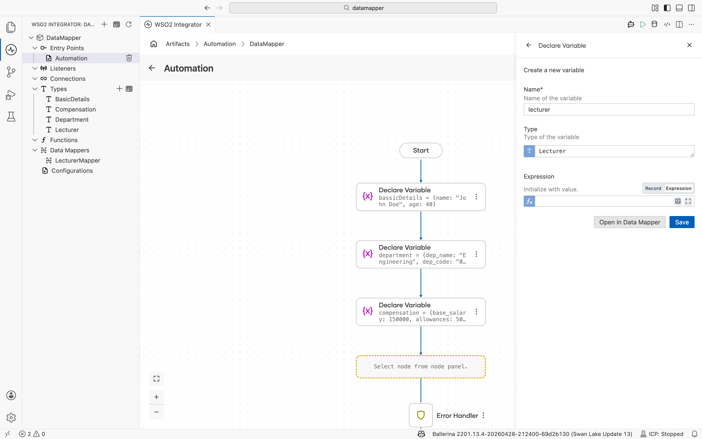

When a flow contains a **Declare Variable** node and the selected type is a record or record array, the side panel shows an **Open in Data Mapper** option. Select it to map the value inline without creating a separate artifact.

The data mapper opens scoped to the variable's type. See [Mapping capabilities](../mapping-capabilities.mdx) for connecting fields, writing expressions, and AI-assisted mapping.

## What's next

- [Reusable data mapper](./reusable.mdx) — Create a data mapper artifact from the **Artifacts** page or the sidebar.
- [Mapping capabilities](../mapping-capabilities.mdx) — Connect fields, write expressions, and use AI-assisted mapping.
- [Array mappings](../array-mappings/index.mdx) — Map between arrays using iteration, joins, and aggregation.
