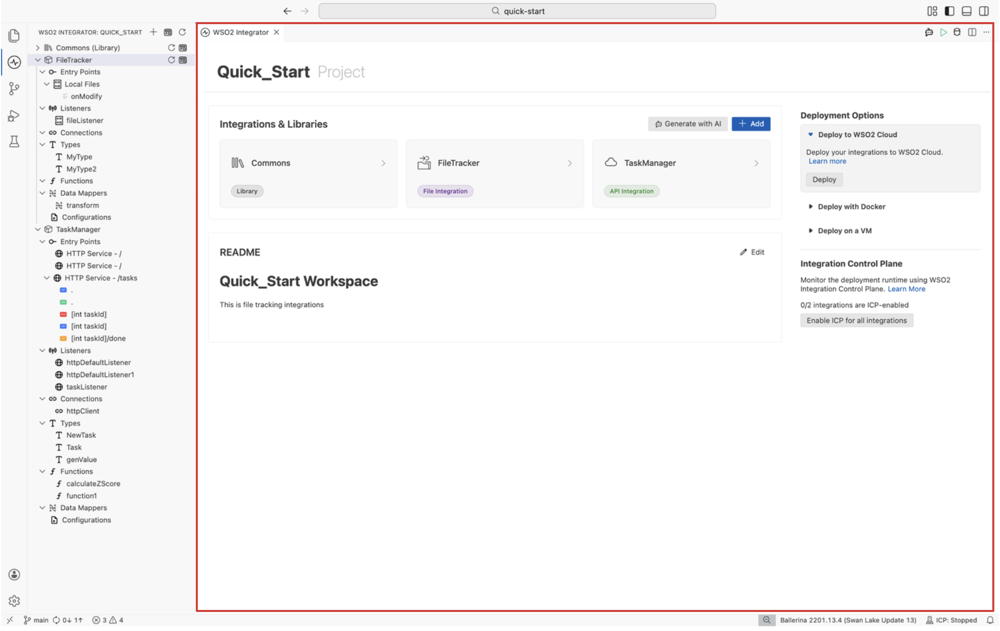
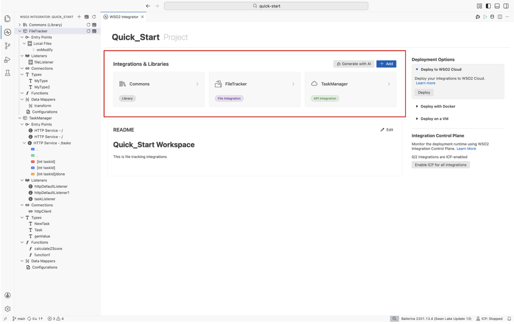
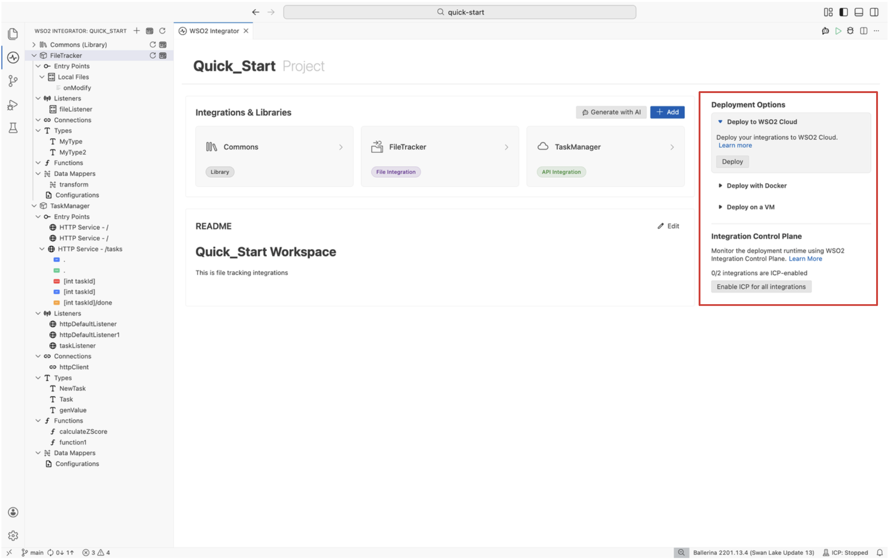
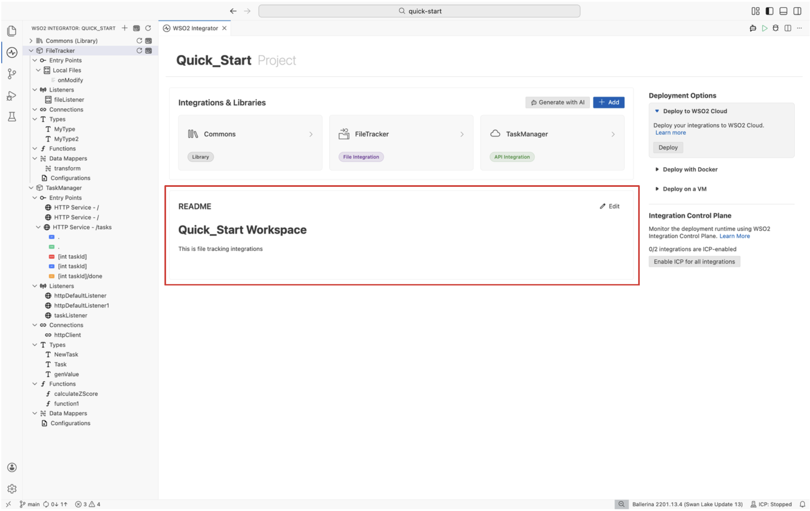

The Project view is the top-level view in WSO2 Integrator. It appears when you open a project that contains multiple integrations or libraries, giving you an overview of everything in the project, deployment options, and project-level actions in one place.

## Project overview canvas

The project overview canvas is the central area of the Project view. It displays the project name as a heading and provides a unified dashboard for managing all integrations and libraries in the project.

### Integrations and libraries

The **Integrations & Libraries** section displays a card grid showing each integration and library in the project. Each card shows:

- The name (for example, `Integration1`, `Library1`).
- A type badge on libraries (for example, `Library`) to distinguish them from integrations.

Click any card to navigate to the [Integrator view](./integration-view.mdx) or [Library view](./library-view.mdx), where you can build and manage its artifacts.

### Generate with AI

Click the **Generate with AI** button at the top of the canvas to open the [WSO2 Integrator Copilot](../../copilot/getting-started.mdx). Describe what you want in natural language, and WSO2 Integrator Copilot generates the integration with the appropriate entry points, connections, and logic.

### Add integration or library

Click the **+ Add** button at the top of the canvas to add a new integration or library to the project. Select the type, provide a name and configuration, and the new entry appears in the card grid and project explorer.

## Deployment options panel

The deployment options panel appears on the right sidebar and provides shortcuts to deploy your integrations to different environments.

| Option | Target |
|---|---|
| [**Deploy to WSO2 Cloud**](../../../../deploy-and-operate/deploy/cloud/index.mdx) | Fully managed cloud platform for hosting and running integrations. |
| [**Containerized Deployment**](../../../../deploy-and-operate/deploy/self-hosted/containerized-deployment.mdx) | Build Docker images and deploy integrations to Docker, Kubernetes, or OpenShift. |
| [**VM Deployment**](../../../../deploy-and-operate/deploy/self-hosted/vm-deployment.mdx) | Deploy integrations as standalone JAR files on virtual machines. |
| [**Integration Control Plane (ICP)**](../../../../deploy-and-operate/deploy/observe/supported-platforms/integration-control-plane-icp.mdx) | Monitor and manage running integrations from a centralized dashboard. |

At the project level, click **Enable ICP for all integrations** to activate ICP monitoring for every integration in the project at once.

## README section

The README section at the bottom of the Project view displays the contents of your project's `README.md` file. Use it to document the purpose, setup instructions, and usage notes for your project, integrations, and libraries.

Click **Edit** to modify the README directly. If the project does not have a README yet, click **Add a README** to create one.

## What's next

- [Integrator view](./integration-view.mdx) — The primary development interface for individual integrations.
- [Library view](./library-view.mdx) — Build and manage reusable libraries.
